<a href="https://github.com/ashokram-si"></a>

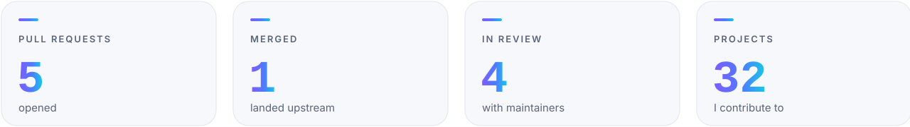

### Contributions

<a href="https://github.com/tauri-apps/tauri/pull/16398">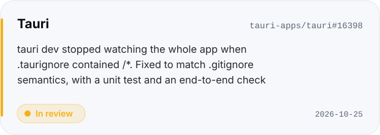</a>
<a href="https://github.com/storytold/photocraft/pull/9516">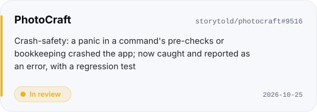</a>
<a href="https://github.com/storytold/vectorcraft/issues/3837#issuecomment-6401739771">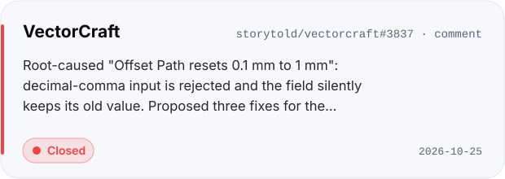</a>
<a href="https://github.com/biomejs/biome/pull/12684">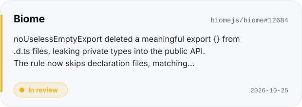</a>
<a href="https://github.com/ggml-org/llama.cpp/pull/31161">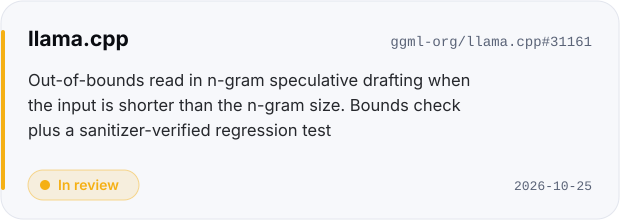</a>
<a href="https://github.com/storytold/vectorcraft/pull/4215">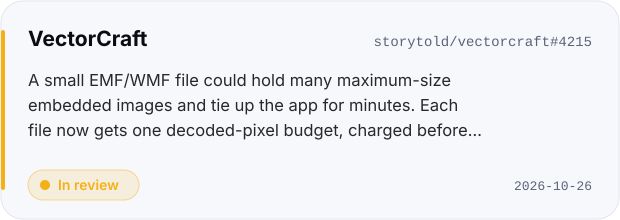</a>
<a href="https://github.com/storytold/cadcraft/pull/2202">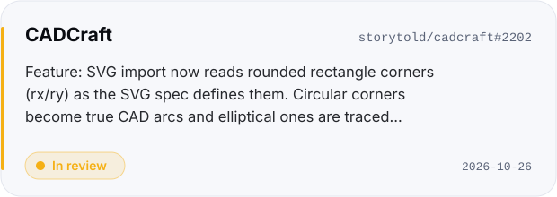</a>

Every card links to the pull request or issue. Status updates automatically as maintainers review.

### Projects I contribute to

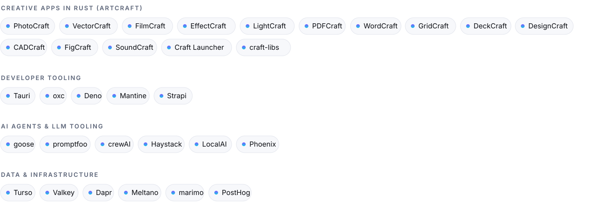

Project links

- **Creative apps in Rust (ArtCraft):** [PhotoCraft](https://github.com/storytold/photocraft) · [VectorCraft](https://github.com/storytold/vectorcraft) · [FilmCraft](https://github.com/storytold/filmcraft) · [EffectCraft](https://github.com/storytold/effectcraft) · [LightCraft](https://github.com/storytold/lightcraft) · [PDFCraft](https://github.com/storytold/pdfcraft) · [WordCraft](https://github.com/storytold/wordcraft) · [GridCraft](https://github.com/storytold/gridcraft) · [DeckCraft](https://github.com/storytold/deckcraft) · [DesignCraft](https://github.com/storytold/designcraft) · [CADCraft](https://github.com/storytold/cadcraft) · [FigCraft](https://github.com/storytold/figcraft) · [SoundCraft](https://github.com/storytold/soundcraft) · [Craft Launcher](https://github.com/storytold/craft-launcher) · [craft-libs](https://github.com/storytold/craft-libs)
- **Developer tooling:** [Tauri](https://github.com/tauri-apps/tauri) · [oxc](https://github.com/oxc-project/oxc) · [Deno](https://github.com/denoland/deno) · [Mantine](https://github.com/mantinedev/mantine) · [Strapi](https://github.com/strapi/strapi)
- **AI agents &amp; LLM tooling:** [goose](https://github.com/aaif-goose/goose) · [promptfoo](https://github.com/promptfoo/promptfoo) · [crewAI](https://github.com/crewAIInc/crewAI) · [Haystack](https://github.com/deepset-ai/haystack) · [LocalAI](https://github.com/mudler/LocalAI) · [Phoenix](https://github.com/Arize-ai/phoenix)
- **Data &amp; infrastructure:** [Turso](https://github.com/tursodatabase/turso) · [Valkey](https://github.com/valkey-io/valkey) · [Dapr](https://github.com/dapr/dapr) · [Meltano](https://github.com/meltano/meltano) · [marimo](https://github.com/marimo-team/marimo) · [PostHog](https://github.com/PostHog/posthog)

### How I work

- **Features and tasks first:** work from each project's roadmap, gap list or maintainer-endorsed issues, checked to be unclaimed.
- **Bugs, confirmed:** reproduced on the latest code before any change.
- **Tested:** every change ships with tests (a regression test for each fix), plus the project's own lint, format and test gates.
- **Small and focused:** one issue per pull request, the project's template filled in completely.
- **Respectful of each project's rules:** conventions, changelogs and AI policies followed exactly.
- **Transparent about AI:** I use AI assistance (Claude Code) where a project allows it, and disclose it as the project asks.

### Roadmap

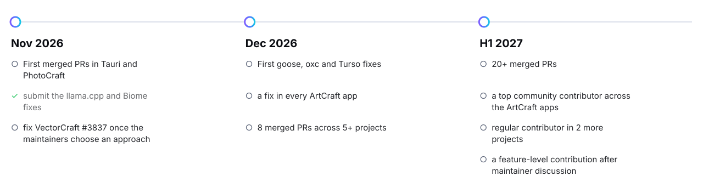

This page is generated from tracked contribution data and refreshed automatically.
