<a href="https://ashokram-si.github.io"><picture><source media="(max-width: 700px)" srcset="assets/hero-m.svg"></picture></a>

<picture><source media="(max-width: 700px)" srcset="assets/stats-m.svg"></picture>

<picture><source media="(max-width: 700px)" srcset="assets/h-01-m.svg"></picture>

<a href="https://github.com/storytold/soundcraft/pulls?q=is%3Apr+author%3Aashokram-si"></a>
<a href="https://github.com/storytold/designcraft/pulls?q=is%3Apr+author%3Aashokram-si"></a>
<a href="https://github.com/storytold/deckcraft/pulls?q=is%3Apr+author%3Aashokram-si"></a>
<a href="https://github.com/grafana/grafana/pulls?q=is%3Apr+author%3Aashokram-si"></a>

<a href="https://github.com/oxc-project/oxc/pulls?q=is%3Apr+author%3Aashokram-si"></a>
<a href="https://github.com/storytold/gridcraft/pulls?q=is%3Apr+author%3Aashokram-si"></a>
<a href="https://github.com/storytold/craft-launcher/pulls?q=is%3Apr+author%3Aashokram-si"></a>
<a href="https://github.com/webpro-nl/knip/commits?author=ashokram-si"></a>
<a href="https://github.com/leptos-rs/leptos/pulls?q=is%3Apr+author%3Aashokram-si"></a>
<a href="https://github.com/prettier/prettier/pulls?q=is%3Apr+author%3Aashokram-si"></a>
<a href="https://github.com/JuliaLang/julia/commits?author=ashokram-si"></a>
<a href="https://github.com/tracel-ai/burn/commits?author=ashokram-si"></a>

<a href="https://github.com/quarkusio/quarkus/pulls?q=is%3Apr+author%3Aashokram-si"></a>
<a href="https://github.com/vectordotdev/vector/pulls?q=is%3Apr+author%3Aashokram-si"></a>

Each tile opens the project's contributors list where my name appears, or my pull requests there while they're in review.

<picture><source media="(max-width: 700px)" srcset="assets/h-02-m.svg"></picture>

<b>Merged</b> · 7

| Project | Type&nbsp;&nbsp;&nbsp;&nbsp;&nbsp;&nbsp;&nbsp;&nbsp;&nbsp;&nbsp;&nbsp;&nbsp;&nbsp;&nbsp;&nbsp;&nbsp;&nbsp;&nbsp;&nbsp;&nbsp;&nbsp; | Contribution | Status | Date |
|:--|:--|:--|:--|:--|
| &nbsp;<b>EffectCraft</b> <a href="https://github.com/storytold/effectcraft/pull/2550">#2550</a> |  | a shape&#x27;s Rectangle and Ellipse Size get the Constrain Proportions chain, off by default |  | 2026‑10‑28 |
| &nbsp;<b>Knip</b> <a href="https://github.com/webpro-nl/knip/pull/2227">#2227</a> |  | Mastra plugin: Mastra&#x27;s CLI finds agents, tools and workflows by folder convention under src/mastra/… |  | 2026‑10‑27 |
| &nbsp;<b>Julia</b> <a href="https://github.com/JuliaLang/julia/pull/64370">#64370</a> |  | first(s, typemax(Int)) returned an empty string for non-ASCII text: nextind overflowed to a negative… |  | 2026‑10‑27 |
| &nbsp;<b>Burn</b> <a href="https://github.com/tracel-ai/burn/pull/6235">#6235</a> |  | average pooling gets dilation, threaded the same way as max pooling through every layer and the… |  | 2026‑10‑27 |
| &nbsp;<b>VectorCraft</b> <a href="https://github.com/storytold/vectorcraft/pull/4215">#4215</a> |  | A small EMF/WMF file could hold many maximum-size embedded images and tie up the app for minutes. Each… |  | 2026‑10‑26 |
| &nbsp;<b>EffectCraft</b> <a href="https://github.com/storytold/effectcraft/pull/2476">#2476</a> |  | the Render Queue now writes Targa (.tga) image sequences: 24-bit RGB, or 32-bit with straight or… |  | 2026‑10‑26 |
| &nbsp;<b>VectorCraft</b> <a href="https://github.com/storytold/vectorcraft/pull/4247">#4247</a> |  | saved views completed: all 25 views are now listed in the View menu (only 10 were), Edit Views opens a… |  | 2026‑10‑26 |

<b>In Review</b> · 26 &nbsp;·&nbsp; page 1 of 3 (1–10 of 26)

| Project | Type&nbsp;&nbsp;&nbsp;&nbsp;&nbsp;&nbsp;&nbsp;&nbsp;&nbsp;&nbsp;&nbsp;&nbsp;&nbsp;&nbsp;&nbsp;&nbsp;&nbsp;&nbsp;&nbsp;&nbsp;&nbsp; | Contribution | Status | Date |
|:--|:--|:--|:--|:--|
| &nbsp;<b>VectorCraft</b> <a href="https://github.com/storytold/vectorcraft/pull/4701">#4701</a> |  | Gradient panel presets: a Presets menu applies a built-in or saved gradient to the selection, keeping… |  | 2026‑10‑30 |
| &nbsp;<b>SoundCraft</b> <a href="https://github.com/storytold/soundcraft/pull/1204">#1204</a> |  | Clip Looping&#x27;s Number of Loops goes up to 1000 loops, the limit looping by length or to the next clip… |  | 2026‑10‑30 |
| &nbsp;<b>SoundCraft</b> <a href="https://github.com/storytold/soundcraft/pull/1203">#1203</a> |  | the macOS menu bar shows each command&#x27;s keyboard shortcut, from the same table as the in-window menus… |  | 2026‑10‑30 |
| &nbsp;<b>DesignCraft</b> <a href="https://github.com/storytold/designcraft/pull/2030">#2030</a> |  | the window title names the open document, with a dot while it has unsaved changes, so a host running… |  | 2026‑10‑30 |
| &nbsp;<b>DeckCraft</b> <a href="https://github.com/storytold/deckcraft/pull/1566">#1566</a> |  | the window title names the open presentation, with a dot while it has unsaved changes, so a host… |  | 2026‑10‑30 |
| &nbsp;<b>Grafana</b> <a href="https://github.com/grafana/grafana/pull/136586">#136586</a> |  | The trace view kept wrong indent guides on span rows after the trace data changed (a new subtrace, or… |  | 2026‑10‑30 |
| &nbsp;<b>Grafana</b> <a href="https://github.com/grafana/grafana/pull/136585">#136585</a> |  | The SQL query builder&#x27;s &quot;Any in&quot; and &quot;Not in&quot; wrote one quoted string (IN (&#x27;a, b, c&#x27;)); each value is… |  | 2026‑10‑30 |
| &nbsp;<b>DesignCraft</b> <a href="https://github.com/storytold/designcraft/pull/1938">#1938</a> |  | Cmd-click with the Selection tool selects the object behind; each further click goes one deeper and… |  | 2026‑10‑28 |
| &nbsp;<b>DeckCraft</b> <a href="https://github.com/storytold/deckcraft/pull/1485">#1485</a> |  | the Reuse Slides picker shows a thumbnail of each slide beside its title |  | 2026‑10‑28 |
| &nbsp;<b>PhotoCraft</b> <a href="https://github.com/storytold/photocraft/pull/9952">#9952</a> |  | JPEG Options shows how big the file will be, updating as quality and format change |  | 2026‑10‑28 |

<b>In Review</b> · 26 &nbsp;·&nbsp; page 2 of 3 (11–20 of 26)

| Project | Type&nbsp;&nbsp;&nbsp;&nbsp;&nbsp;&nbsp;&nbsp;&nbsp;&nbsp;&nbsp;&nbsp;&nbsp;&nbsp;&nbsp;&nbsp;&nbsp;&nbsp;&nbsp;&nbsp;&nbsp;&nbsp; | Contribution | Status | Date |
|:--|:--|:--|:--|:--|
| &nbsp;<b>SoundCraft</b> <a href="https://github.com/storytold/soundcraft/pull/1156">#1156</a> |  | A movie whose file is gone kept its raw stored path and was never marked offline, so the Video track… |  | 2026‑10‑28 |
| &nbsp;<b>SoundCraft</b> <a href="https://github.com/storytold/soundcraft/pull/1157">#1157</a> |  | A refused MIDI file (track longer than a day) left tracks and a new tempo map behind with no undo; the… |  | 2026‑10‑28 |
| &nbsp;<b>DesignCraft</b> <a href="https://github.com/storytold/designcraft/pull/1936">#1936</a> |  | a spine line where the pages of a spread meet, screen-only, hidden with the other guides and in preview… |  | 2026‑10‑28 |
| &nbsp;<b>Grafana</b> <a href="https://github.com/grafana/grafana/pull/136236">#136236</a> |  | Table Gauge cells: bar widths didn&#x27;t match the values because an inverted comparison let the… |  | 2026‑10‑28 |
| &nbsp;<b>Prettier</b> <a href="https://github.com/prettier/prettier/pull/20377">#20377</a> |  | A comment just inside the ( of a label&#x27;s body moved on every format run. It is now attached to the… |  | 2026‑10‑27 |
| &nbsp;<b>Quarkus</b> <a href="https://github.com/quarkusio/quarkus/pull/57866">#57866</a> |  | quarkus:dev generated code before application.properties was copied, so gRPC settings like… |  | 2026‑10‑27 |
| &nbsp;<b>Vector</b> <a href="https://github.com/vectordotdev/vector/pull/26886">#26886</a> |  | Compressing sinks (Loki, HTTP, S3 and others) reported compressed bytes in component_sent_bytes_total… |  | 2026‑10‑27 |
| &nbsp;<b>CADCraft</b> <a href="https://github.com/storytold/cadcraft/pull/2202">#2202</a> |  | SVG import now reads rounded rectangle corners (rx/ry) as the SVG spec defines them. Circular corners… |  | 2026‑10‑26 |
| &nbsp;<b>Turso</b> <a href="https://github.com/tursodatabase/turso/pull/10829">#10829</a> |  | PRAGMA data_version, the cheap SQLite way to poll for changes. It moves when another connection or… |  | 2026‑10‑26 |
| &nbsp;<b>oxc</b> <a href="https://github.com/oxc-project/oxc/pull/28181">#28181</a> |  | Parser fix: a regex like (/&lt;!-- x --&gt;/) in a module was wrongly read as an HTML comment (and crashed… |  | 2026‑10‑26 |

<b>In Review</b> · 26 &nbsp;·&nbsp; page 3 of 3 (21–26 of 26)

| Project | Type&nbsp;&nbsp;&nbsp;&nbsp;&nbsp;&nbsp;&nbsp;&nbsp;&nbsp;&nbsp;&nbsp;&nbsp;&nbsp;&nbsp;&nbsp;&nbsp;&nbsp;&nbsp;&nbsp;&nbsp;&nbsp; | Contribution | Status | Date |
|:--|:--|:--|:--|:--|
| &nbsp;<b>GridCraft</b> <a href="https://github.com/storytold/gridcraft/pull/2642">#2642</a> |  | After saving a CSV, Save in the close dialog asked again forever. It now closes once the file is… |  | 2026‑10‑26 |
| &nbsp;<b>Craft Launcher</b> <a href="https://github.com/storytold/craft-launcher/pull/912">#912</a> |  | Security: the macOS install check could follow a planted symlink and empty another file. It now probes… |  | 2026‑10‑26 |
| &nbsp;<b>Tauri</b> <a href="https://github.com/tauri-apps/tauri/pull/16398">#16398</a> |  | tauri dev stopped watching the whole app when .taurignore contained /*. Watch folders are now always… |  | 2026‑10‑25 |
| &nbsp;<b>PhotoCraft</b> <a href="https://github.com/storytold/photocraft/pull/9516">#9516</a> |  | Crash-safety: a panic in a command&#x27;s pre-checks or bookkeeping crashed the app; now caught and reported… |  | 2026‑10‑25 |
| &nbsp;<b>Biome</b> <a href="https://github.com/biomejs/biome/pull/12684">#12684</a> |  | noUselessEmptyExport deleted a meaningful export {} from .d.ts files, leaking private types into the… |  | 2026‑10‑25 |
| &nbsp;<b>llama.cpp</b> <a href="https://github.com/ggml-org/llama.cpp/pull/31161">#31161</a> |  | Out-of-bounds read in n-gram speculative drafting when the input is shorter than the n-gram size… |  | 2026‑10‑25 |

<b>Closed</b> · 3

| Project | Type&nbsp;&nbsp;&nbsp;&nbsp;&nbsp;&nbsp;&nbsp;&nbsp;&nbsp;&nbsp;&nbsp;&nbsp;&nbsp;&nbsp;&nbsp;&nbsp;&nbsp;&nbsp;&nbsp;&nbsp;&nbsp; | Contribution | Status | Date |
|:--|:--|:--|:--|:--|
| &nbsp;<b>Leptos</b> <a href="https://github.com/leptos-rs/leptos/pull/4974">#4974</a> |  | Islands never hydrated on a page whose main thread never goes idle: island_script.js waited on… |  | 2026‑10‑27 |
| &nbsp;<b>Hugo</b> <a href="https://github.com/gohugoio/hugo/pull/15488">#15488</a> |  | Tailwind @import &quot;./x.css&quot; failed with disableInlineImports: the CSS goes to the CLI on stdin, so… |  | 2026‑10‑27 |
| &nbsp;<b>VectorCraft</b> <a href="https://github.com/storytold/vectorcraft/issues/3837#issuecomment-6401739771">#3837 · comment</a> |  | Root-caused &quot;Offset Path resets 0.1 mm to 1 mm&quot;: decimal-comma input is rejected and the field silently… |  | 2026‑10‑25 |

<b>All</b> · 36 &nbsp;·&nbsp; page 1 of 4 (1–10 of 36)

| Project | Type&nbsp;&nbsp;&nbsp;&nbsp;&nbsp;&nbsp;&nbsp;&nbsp;&nbsp;&nbsp;&nbsp;&nbsp;&nbsp;&nbsp;&nbsp;&nbsp;&nbsp;&nbsp;&nbsp;&nbsp;&nbsp; | Contribution | Status | Date |
|:--|:--|:--|:--|:--|
| &nbsp;<b>VectorCraft</b> <a href="https://github.com/storytold/vectorcraft/pull/4701">#4701</a> |  | Gradient panel presets: a Presets menu applies a built-in or saved gradient to the selection, keeping… |  | 2026‑10‑30 |
| &nbsp;<b>SoundCraft</b> <a href="https://github.com/storytold/soundcraft/pull/1204">#1204</a> |  | Clip Looping&#x27;s Number of Loops goes up to 1000 loops, the limit looping by length or to the next clip… |  | 2026‑10‑30 |
| &nbsp;<b>SoundCraft</b> <a href="https://github.com/storytold/soundcraft/pull/1203">#1203</a> |  | the macOS menu bar shows each command&#x27;s keyboard shortcut, from the same table as the in-window menus… |  | 2026‑10‑30 |
| &nbsp;<b>DesignCraft</b> <a href="https://github.com/storytold/designcraft/pull/2030">#2030</a> |  | the window title names the open document, with a dot while it has unsaved changes, so a host running… |  | 2026‑10‑30 |
| &nbsp;<b>DeckCraft</b> <a href="https://github.com/storytold/deckcraft/pull/1566">#1566</a> |  | the window title names the open presentation, with a dot while it has unsaved changes, so a host… |  | 2026‑10‑30 |
| &nbsp;<b>Grafana</b> <a href="https://github.com/grafana/grafana/pull/136586">#136586</a> |  | The trace view kept wrong indent guides on span rows after the trace data changed (a new subtrace, or… |  | 2026‑10‑30 |
| &nbsp;<b>Grafana</b> <a href="https://github.com/grafana/grafana/pull/136585">#136585</a> |  | The SQL query builder&#x27;s &quot;Any in&quot; and &quot;Not in&quot; wrote one quoted string (IN (&#x27;a, b, c&#x27;)); each value is… |  | 2026‑10‑30 |
| &nbsp;<b>DesignCraft</b> <a href="https://github.com/storytold/designcraft/pull/1938">#1938</a> |  | Cmd-click with the Selection tool selects the object behind; each further click goes one deeper and… |  | 2026‑10‑28 |
| &nbsp;<b>EffectCraft</b> <a href="https://github.com/storytold/effectcraft/pull/2550">#2550</a> |  | a shape&#x27;s Rectangle and Ellipse Size get the Constrain Proportions chain, off by default |  | 2026‑10‑28 |
| &nbsp;<b>DeckCraft</b> <a href="https://github.com/storytold/deckcraft/pull/1485">#1485</a> |  | the Reuse Slides picker shows a thumbnail of each slide beside its title |  | 2026‑10‑28 |

<b>All</b> · 36 &nbsp;·&nbsp; page 2 of 4 (11–20 of 36)

| Project | Type&nbsp;&nbsp;&nbsp;&nbsp;&nbsp;&nbsp;&nbsp;&nbsp;&nbsp;&nbsp;&nbsp;&nbsp;&nbsp;&nbsp;&nbsp;&nbsp;&nbsp;&nbsp;&nbsp;&nbsp;&nbsp; | Contribution | Status | Date |
|:--|:--|:--|:--|:--|
| &nbsp;<b>PhotoCraft</b> <a href="https://github.com/storytold/photocraft/pull/9952">#9952</a> |  | JPEG Options shows how big the file will be, updating as quality and format change |  | 2026‑10‑28 |
| &nbsp;<b>SoundCraft</b> <a href="https://github.com/storytold/soundcraft/pull/1156">#1156</a> |  | A movie whose file is gone kept its raw stored path and was never marked offline, so the Video track… |  | 2026‑10‑28 |
| &nbsp;<b>SoundCraft</b> <a href="https://github.com/storytold/soundcraft/pull/1157">#1157</a> |  | A refused MIDI file (track longer than a day) left tracks and a new tempo map behind with no undo; the… |  | 2026‑10‑28 |
| &nbsp;<b>DesignCraft</b> <a href="https://github.com/storytold/designcraft/pull/1936">#1936</a> |  | a spine line where the pages of a spread meet, screen-only, hidden with the other guides and in preview… |  | 2026‑10‑28 |
| &nbsp;<b>Grafana</b> <a href="https://github.com/grafana/grafana/pull/136236">#136236</a> |  | Table Gauge cells: bar widths didn&#x27;t match the values because an inverted comparison let the… |  | 2026‑10‑28 |
| &nbsp;<b>Knip</b> <a href="https://github.com/webpro-nl/knip/pull/2227">#2227</a> |  | Mastra plugin: Mastra&#x27;s CLI finds agents, tools and workflows by folder convention under src/mastra/… |  | 2026‑10‑27 |
| &nbsp;<b>Leptos</b> <a href="https://github.com/leptos-rs/leptos/pull/4974">#4974</a> |  | Islands never hydrated on a page whose main thread never goes idle: island_script.js waited on… |  | 2026‑10‑27 |
| &nbsp;<b>Prettier</b> <a href="https://github.com/prettier/prettier/pull/20377">#20377</a> |  | A comment just inside the ( of a label&#x27;s body moved on every format run. It is now attached to the… |  | 2026‑10‑27 |
| &nbsp;<b>Julia</b> <a href="https://github.com/JuliaLang/julia/pull/64370">#64370</a> |  | first(s, typemax(Int)) returned an empty string for non-ASCII text: nextind overflowed to a negative… |  | 2026‑10‑27 |
| &nbsp;<b>Burn</b> <a href="https://github.com/tracel-ai/burn/pull/6235">#6235</a> |  | average pooling gets dilation, threaded the same way as max pooling through every layer and the… |  | 2026‑10‑27 |

<b>All</b> · 36 &nbsp;·&nbsp; page 3 of 4 (21–30 of 36)

| Project | Type&nbsp;&nbsp;&nbsp;&nbsp;&nbsp;&nbsp;&nbsp;&nbsp;&nbsp;&nbsp;&nbsp;&nbsp;&nbsp;&nbsp;&nbsp;&nbsp;&nbsp;&nbsp;&nbsp;&nbsp;&nbsp; | Contribution | Status | Date |
|:--|:--|:--|:--|:--|
| &nbsp;<b>Hugo</b> <a href="https://github.com/gohugoio/hugo/pull/15488">#15488</a> |  | Tailwind @import &quot;./x.css&quot; failed with disableInlineImports: the CSS goes to the CLI on stdin, so… |  | 2026‑10‑27 |
| &nbsp;<b>Quarkus</b> <a href="https://github.com/quarkusio/quarkus/pull/57866">#57866</a> |  | quarkus:dev generated code before application.properties was copied, so gRPC settings like… |  | 2026‑10‑27 |
| &nbsp;<b>Vector</b> <a href="https://github.com/vectordotdev/vector/pull/26886">#26886</a> |  | Compressing sinks (Loki, HTTP, S3 and others) reported compressed bytes in component_sent_bytes_total… |  | 2026‑10‑27 |
| &nbsp;<b>VectorCraft</b> <a href="https://github.com/storytold/vectorcraft/pull/4215">#4215</a> |  | A small EMF/WMF file could hold many maximum-size embedded images and tie up the app for minutes. Each… |  | 2026‑10‑26 |
| &nbsp;<b>CADCraft</b> <a href="https://github.com/storytold/cadcraft/pull/2202">#2202</a> |  | SVG import now reads rounded rectangle corners (rx/ry) as the SVG spec defines them. Circular corners… |  | 2026‑10‑26 |
| &nbsp;<b>Turso</b> <a href="https://github.com/tursodatabase/turso/pull/10829">#10829</a> |  | PRAGMA data_version, the cheap SQLite way to poll for changes. It moves when another connection or… |  | 2026‑10‑26 |
| &nbsp;<b>EffectCraft</b> <a href="https://github.com/storytold/effectcraft/pull/2476">#2476</a> |  | the Render Queue now writes Targa (.tga) image sequences: 24-bit RGB, or 32-bit with straight or… |  | 2026‑10‑26 |
| &nbsp;<b>VectorCraft</b> <a href="https://github.com/storytold/vectorcraft/pull/4247">#4247</a> |  | saved views completed: all 25 views are now listed in the View menu (only 10 were), Edit Views opens a… |  | 2026‑10‑26 |
| &nbsp;<b>oxc</b> <a href="https://github.com/oxc-project/oxc/pull/28181">#28181</a> |  | Parser fix: a regex like (/&lt;!-- x --&gt;/) in a module was wrongly read as an HTML comment (and crashed… |  | 2026‑10‑26 |
| &nbsp;<b>GridCraft</b> <a href="https://github.com/storytold/gridcraft/pull/2642">#2642</a> |  | After saving a CSV, Save in the close dialog asked again forever. It now closes once the file is… |  | 2026‑10‑26 |

<b>All</b> · 36 &nbsp;·&nbsp; page 4 of 4 (31–36 of 36)

| Project | Type&nbsp;&nbsp;&nbsp;&nbsp;&nbsp;&nbsp;&nbsp;&nbsp;&nbsp;&nbsp;&nbsp;&nbsp;&nbsp;&nbsp;&nbsp;&nbsp;&nbsp;&nbsp;&nbsp;&nbsp;&nbsp; | Contribution | Status | Date |
|:--|:--|:--|:--|:--|
| &nbsp;<b>Craft Launcher</b> <a href="https://github.com/storytold/craft-launcher/pull/912">#912</a> |  | Security: the macOS install check could follow a planted symlink and empty another file. It now probes… |  | 2026‑10‑26 |
| &nbsp;<b>Tauri</b> <a href="https://github.com/tauri-apps/tauri/pull/16398">#16398</a> |  | tauri dev stopped watching the whole app when .taurignore contained /*. Watch folders are now always… |  | 2026‑10‑25 |
| &nbsp;<b>PhotoCraft</b> <a href="https://github.com/storytold/photocraft/pull/9516">#9516</a> |  | Crash-safety: a panic in a command&#x27;s pre-checks or bookkeeping crashed the app; now caught and reported… |  | 2026‑10‑25 |
| &nbsp;<b>VectorCraft</b> <a href="https://github.com/storytold/vectorcraft/issues/3837#issuecomment-6401739771">#3837 · comment</a> |  | Root-caused &quot;Offset Path resets 0.1 mm to 1 mm&quot;: decimal-comma input is rejected and the field silently… |  | 2026‑10‑25 |
| &nbsp;<b>Biome</b> <a href="https://github.com/biomejs/biome/pull/12684">#12684</a> |  | noUselessEmptyExport deleted a meaningful export {} from .d.ts files, leaking private types into the… |  | 2026‑10‑25 |
| &nbsp;<b>llama.cpp</b> <a href="https://github.com/ggml-org/llama.cpp/pull/31161">#31161</a> |  | Out-of-bounds read in n-gram speculative drafting when the input is shorter than the n-gram size… |  | 2026‑10‑25 |

Merged first, newest first, 10 a page. Open another status or All to see the rest; every link goes to the pull request or issue.

<picture><source media="(max-width: 700px)" srcset="assets/h-03-m.svg"></picture>

<picture><source media="(max-width: 700px)" srcset="assets/interests-m.svg"></picture>

Project links

- **Creative apps in Rust (ArtCraft):** [PhotoCraft](https://github.com/storytold/photocraft) · [VectorCraft](https://github.com/storytold/vectorcraft) · [FilmCraft](https://github.com/storytold/filmcraft) · [EffectCraft](https://github.com/storytold/effectcraft) · [LightCraft](https://github.com/storytold/lightcraft) · [PDFCraft](https://github.com/storytold/pdfcraft) · [WordCraft](https://github.com/storytold/wordcraft) · [GridCraft](https://github.com/storytold/gridcraft) · [DeckCraft](https://github.com/storytold/deckcraft) · [DesignCraft](https://github.com/storytold/designcraft) · [CADCraft](https://github.com/storytold/cadcraft) · [FigCraft](https://github.com/storytold/figcraft) · [SoundCraft](https://github.com/storytold/soundcraft) · [Craft Launcher](https://github.com/storytold/craft-launcher) · [craft-libs](https://github.com/storytold/craft-libs)
- **Developer tooling:** [Tauri](https://github.com/tauri-apps/tauri) · [oxc](https://github.com/oxc-project/oxc) · [Deno](https://github.com/denoland/deno) · [Mantine](https://github.com/mantinedev/mantine) · [Strapi](https://github.com/strapi/strapi) · [Knip](https://github.com/webpro-nl/knip) · [Prettier](https://github.com/prettier/prettier) · [Leptos](https://github.com/leptos-rs/leptos) · [Hugo](https://github.com/gohugoio/hugo) · [Quarkus](https://github.com/quarkusio/quarkus) · [Julia](https://github.com/JuliaLang/julia)
- **AI agents &amp; LLM tooling:** [goose](https://github.com/aaif-goose/goose) · [promptfoo](https://github.com/promptfoo/promptfoo) · [crewAI](https://github.com/crewAIInc/crewAI) · [Haystack](https://github.com/deepset-ai/haystack) · [LocalAI](https://github.com/mudler/LocalAI) · [Phoenix](https://github.com/Arize-ai/phoenix) · [Burn](https://github.com/tracel-ai/burn)
- **Data &amp; infrastructure:** [Turso](https://github.com/tursodatabase/turso) · [Valkey](https://github.com/valkey-io/valkey) · [Dapr](https://github.com/dapr/dapr) · [Meltano](https://github.com/meltano/meltano) · [marimo](https://github.com/marimo-team/marimo) · [PostHog](https://github.com/PostHog/posthog) · [Vector](https://github.com/vectordotdev/vector)

<picture><source media="(max-width: 700px)" srcset="assets/h-04-m.svg"></picture>

- **Features and tasks first:** from each project's roadmap, gap list or maintainer-endorsed issues, checked to be unclaimed.
- **Bugs, confirmed:** reproduced on the latest code before any change.
- **Tested:** every change ships with tests, plus the project's own lint, format and test gates.
- **Small and focused:** one issue per pull request, the project's template filled in completely.
- **Each project's rules:** conventions, changelogs and AI policies followed exactly.
- **Transparent about AI:** AI assistance (Claude Code) only where a project allows it, disclosed as it asks.

<a href="https://ashokram-si.github.io"><picture><source media="(max-width: 700px)" srcset="assets/site-m.svg"></picture></a>

Generated from tracked contribution data and refreshed automatically.
