<a href="https://ashokram-si.github.io"><picture><source media="(max-width: 700px)" srcset="assets/hero-m.svg"></picture></a>

<picture><source media="(max-width: 700px)" srcset="assets/stats-m.svg"></picture>

<picture><source media="(max-width: 700px)" srcset="assets/h-01-m.svg"></picture>

<a href="https://github.com/tauri-apps/tauri/pulls?q=is%3Apr+author%3Aashokram-si"></a>
<a href="https://github.com/storytold/photocraft/pulls?q=is%3Apr+author%3Aashokram-si"></a>
<a href="https://github.com/storytold/vectorcraft/commits?author=ashokram-si"></a>
<a href="https://github.com/biomejs/biome/pulls?q=is%3Apr+author%3Aashokram-si"></a>
<a href="https://github.com/ggml-org/llama.cpp/pulls?q=is%3Apr+author%3Aashokram-si"></a>
<a href="https://github.com/storytold/cadcraft/pulls?q=is%3Apr+author%3Aashokram-si"></a>
<a href="https://github.com/tursodatabase/turso/pulls?q=is%3Apr+author%3Aashokram-si"></a>
<a href="https://github.com/storytold/effectcraft/pulls?q=is%3Apr+author%3Aashokram-si"></a>

Each tile opens the project's contributors list where my name appears, or my pull requests there while they're in review.

<picture><source media="(max-width: 700px)" srcset="assets/h-02-m.svg"></picture>

<b>All</b> · 10

| Project | Contribution | Status | Date |
|:--|:--|:--|:--|
| &nbsp;<b>VectorCraft</b> <a href="https://github.com/storytold/vectorcraft/pull/4215">#4215</a> | <b>BUG FIX</b> A small EMF/WMF file could hold many maximum-size embedded images and tie up the app for minutes. Each… |  | 2026‑10‑26 |
| &nbsp;<b>CADCraft</b> <a href="https://github.com/storytold/cadcraft/pull/2202">#2202</a> | <b>FEATURE</b> SVG import now reads rounded rectangle corners (rx/ry) as the SVG spec defines them. Circular corners… |  | 2026‑10‑26 |
| &nbsp;<b>Turso</b> <a href="https://github.com/tursodatabase/turso/pull/10829">#10829</a> | <b>FEATURE</b> PRAGMA data_version, the cheap SQLite way to poll for changes. It moves when another connection or… |  | 2026‑10‑26 |
| &nbsp;<b>EffectCraft</b> <a href="https://github.com/storytold/effectcraft/pull/2476">#2476</a> | <b>FEATURE</b> the Render Queue now writes Targa (.tga) image sequences: 24-bit RGB, or 32-bit with straight or… |  | 2026‑10‑26 |
| &nbsp;<b>VectorCraft</b> <a href="https://github.com/storytold/vectorcraft/pull/4247">#4247</a> | <b>FEATURE</b> saved views completed: all 25 views are now listed in the View menu (only 10 were), Edit Views opens a… |  | 2026‑10‑26 |
| &nbsp;<b>Tauri</b> <a href="https://github.com/tauri-apps/tauri/pull/16398">#16398</a> | <b>BUG FIX</b> tauri dev stopped watching the whole app when .taurignore contained /*. Fixed to match .gitignore… |  | 2026‑10‑25 |
| &nbsp;<b>PhotoCraft</b> <a href="https://github.com/storytold/photocraft/pull/9516">#9516</a> | <b>BUG FIX</b> Crash-safety: a panic in a command&#x27;s pre-checks or bookkeeping crashed the app; now caught and reported… |  | 2026‑10‑25 |
| &nbsp;<b>VectorCraft</b> <a href="https://github.com/storytold/vectorcraft/issues/3837#issuecomment-6401739771">#3837 · comment</a> | <b>INVESTIGATION</b> Root-caused &quot;Offset Path resets 0.1 mm to 1 mm&quot;: decimal-comma input is rejected and the field silently… |  | 2026‑10‑25 |
| &nbsp;<b>Biome</b> <a href="https://github.com/biomejs/biome/pull/12684">#12684</a> | <b>BUG FIX</b> noUselessEmptyExport deleted a meaningful export {} from .d.ts files, leaking private types into the… |  | 2026‑10‑25 |
| &nbsp;<b>llama.cpp</b> <a href="https://github.com/ggml-org/llama.cpp/pull/31161">#31161</a> | <b>BUG FIX</b> Out-of-bounds read in n-gram speculative drafting when the input is shorter than the n-gram size… |  | 2026‑10‑25 |

<b>Merged</b> · 1

| Project | Contribution | Status | Date |
|:--|:--|:--|:--|
| &nbsp;<b>VectorCraft</b> <a href="https://github.com/storytold/vectorcraft/pull/4215">#4215</a> | <b>BUG FIX</b> A small EMF/WMF file could hold many maximum-size embedded images and tie up the app for minutes. Each… |  | 2026‑10‑26 |

<b>In Review</b> · 8

| Project | Contribution | Status | Date |
|:--|:--|:--|:--|
| &nbsp;<b>CADCraft</b> <a href="https://github.com/storytold/cadcraft/pull/2202">#2202</a> | <b>FEATURE</b> SVG import now reads rounded rectangle corners (rx/ry) as the SVG spec defines them. Circular corners… |  | 2026‑10‑26 |
| &nbsp;<b>Turso</b> <a href="https://github.com/tursodatabase/turso/pull/10829">#10829</a> | <b>FEATURE</b> PRAGMA data_version, the cheap SQLite way to poll for changes. It moves when another connection or… |  | 2026‑10‑26 |
| &nbsp;<b>EffectCraft</b> <a href="https://github.com/storytold/effectcraft/pull/2476">#2476</a> | <b>FEATURE</b> the Render Queue now writes Targa (.tga) image sequences: 24-bit RGB, or 32-bit with straight or… |  | 2026‑10‑26 |
| &nbsp;<b>VectorCraft</b> <a href="https://github.com/storytold/vectorcraft/pull/4247">#4247</a> | <b>FEATURE</b> saved views completed: all 25 views are now listed in the View menu (only 10 were), Edit Views opens a… |  | 2026‑10‑26 |
| &nbsp;<b>Tauri</b> <a href="https://github.com/tauri-apps/tauri/pull/16398">#16398</a> | <b>BUG FIX</b> tauri dev stopped watching the whole app when .taurignore contained /*. Fixed to match .gitignore… |  | 2026‑10‑25 |
| &nbsp;<b>PhotoCraft</b> <a href="https://github.com/storytold/photocraft/pull/9516">#9516</a> | <b>BUG FIX</b> Crash-safety: a panic in a command&#x27;s pre-checks or bookkeeping crashed the app; now caught and reported… |  | 2026‑10‑25 |
| &nbsp;<b>Biome</b> <a href="https://github.com/biomejs/biome/pull/12684">#12684</a> | <b>BUG FIX</b> noUselessEmptyExport deleted a meaningful export {} from .d.ts files, leaking private types into the… |  | 2026‑10‑25 |
| &nbsp;<b>llama.cpp</b> <a href="https://github.com/ggml-org/llama.cpp/pull/31161">#31161</a> | <b>BUG FIX</b> Out-of-bounds read in n-gram speculative drafting when the input is shorter than the n-gram size… |  | 2026‑10‑25 |

<b>Closed</b> · 1

| Project | Contribution | Status | Date |
|:--|:--|:--|:--|
| &nbsp;<b>VectorCraft</b> <a href="https://github.com/storytold/vectorcraft/issues/3837#issuecomment-6401739771">#3837 · comment</a> | <b>INVESTIGATION</b> Root-caused &quot;Offset Path resets 0.1 mm to 1 mm&quot;: decimal-comma input is rejected and the field silently… |  | 2026‑10‑25 |

Newest first, 10 a page. Open a status to filter; every link goes to the pull request or issue.

<picture><source media="(max-width: 700px)" srcset="assets/h-03-m.svg"></picture>

<picture><source media="(max-width: 700px)" srcset="assets/interests-m.svg"></picture>

Project links

- **Creative apps in Rust (ArtCraft):** [PhotoCraft](https://github.com/storytold/photocraft) · [VectorCraft](https://github.com/storytold/vectorcraft) · [FilmCraft](https://github.com/storytold/filmcraft) · [EffectCraft](https://github.com/storytold/effectcraft) · [LightCraft](https://github.com/storytold/lightcraft) · [PDFCraft](https://github.com/storytold/pdfcraft) · [WordCraft](https://github.com/storytold/wordcraft) · [GridCraft](https://github.com/storytold/gridcraft) · [DeckCraft](https://github.com/storytold/deckcraft) · [DesignCraft](https://github.com/storytold/designcraft) · [CADCraft](https://github.com/storytold/cadcraft) · [FigCraft](https://github.com/storytold/figcraft) · [SoundCraft](https://github.com/storytold/soundcraft) · [Craft Launcher](https://github.com/storytold/craft-launcher) · [craft-libs](https://github.com/storytold/craft-libs)
- **Developer tooling:** [Tauri](https://github.com/tauri-apps/tauri) · [oxc](https://github.com/oxc-project/oxc) · [Deno](https://github.com/denoland/deno) · [Mantine](https://github.com/mantinedev/mantine) · [Strapi](https://github.com/strapi/strapi)
- **AI agents &amp; LLM tooling:** [goose](https://github.com/aaif-goose/goose) · [promptfoo](https://github.com/promptfoo/promptfoo) · [crewAI](https://github.com/crewAIInc/crewAI) · [Haystack](https://github.com/deepset-ai/haystack) · [LocalAI](https://github.com/mudler/LocalAI) · [Phoenix](https://github.com/Arize-ai/phoenix)
- **Data &amp; infrastructure:** [Turso](https://github.com/tursodatabase/turso) · [Valkey](https://github.com/valkey-io/valkey) · [Dapr](https://github.com/dapr/dapr) · [Meltano](https://github.com/meltano/meltano) · [marimo](https://github.com/marimo-team/marimo) · [PostHog](https://github.com/PostHog/posthog)

<picture><source media="(max-width: 700px)" srcset="assets/h-04-m.svg"></picture>

- **Features and tasks first:** from each project's roadmap, gap list or maintainer-endorsed issues, checked to be unclaimed.
- **Bugs, confirmed:** reproduced on the latest code before any change.
- **Tested:** every change ships with tests, plus the project's own lint, format and test gates.
- **Small and focused:** one issue per pull request, the project's template filled in completely.
- **Each project's rules:** conventions, changelogs and AI policies followed exactly.
- **Transparent about AI:** AI assistance (Claude Code) only where a project allows it, disclosed as it asks.

<a href="https://ashokram-si.github.io"><picture><source media="(max-width: 700px)" srcset="assets/site-m.svg"></picture></a>

Generated from tracked contribution data and refreshed automatically.
